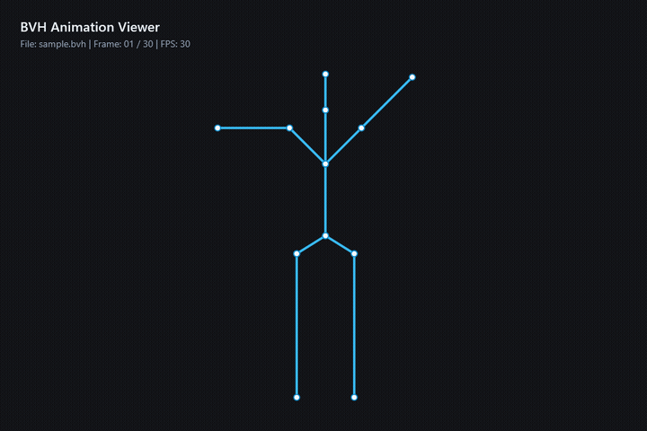

# BVH Skeleton Animation Viewer

一個基於 **C# / WPF (.NET 8)** 的輕量級 3D 骨架動作檢視器與解析器，支援讀取標準 **BVH (Biovision Hierarchy)** 動畫檔案、即時骨骼連線渲染、動作播放控制，並內建常見的 **逆向運動學 (IK) 解算器**。

---

## 📽️ 示範影片與預覽 (Demo)

### 動畫預覽 (GIF)


> 📹 **示範影片下載 / 觀看**：可直接播放或下載儲存庫中的高畫質示範影片：[docs/demo.mp4](docs/demo.mp4)

---

## 🌟 核心功能

1. **標準 BVH 格式解析器 (`BvhParser.cs` & `BvhModel.cs`)**
   - 支援解析完整的樹狀階層結構（`ROOT`、`JOINT`、`End Site`）。
   - 正確處理各關節的 `OFFSET` 以及自由度通道（`CHANNELS`，支援位置與旋轉通道如 `Xposition`, `Yposition`, `Zposition`, `Zrotation`, `Xrotation`, `Yrotation`）。
   - 解析 `MOTION` 區段，包含 `Frames`、`Frame Time` 與連續動作數值矩陣。

2. **骨架即時投影與動態繪製 (`MainWindow.xaml.cs`)**
   - 透過正向運動學（Forward Kinematics, FK）依父子關節階層結合四元數（Quaternion）與空間座標轉換。
   - 動態計算所有動作幀的邊界盒（Bounding Box），自動縮放與置中投影至 2D 畫布。
   - 骨骼與關節高對比色彩渲染（SkyBlue 骨骼、White 關節點），視覺效果清晰直覺。

3. **直覺的播放控制介面**
   - **播放 / 暫停**：即時控制動畫狀態。
   - **時間軸拖曳（Timeline Slider）**：隨意跳轉至任意幀檢視特定動作。
   - **播放倍速切換**：支援 `0.25x`、`0.5x`、`1x`、`2x` 播放速度。
   - **重設功能**：一鍵回到動畫第一幀。
   - **詳細資訊面板**：顯示當前載入檔案、總幀數、單幀時間、總 Channel 數量與目前幀數進度。

4. **逆向運動學解算器模組 (`IkSolver.cs`)**
   - **解析法 (Analytical 2-Bone IK)**：適用於手臂（大臂+小臂）或腿部雙關節快速求角。
   - **循環座標下降法 (CCD IK - Cyclic Coordinate Descent)**：適用於多關節骨骼鏈迭代朝向目標求解。
   - **前後延展法 (FABRIK - Forward And Backward Reaching Inverse Kinematics)**：高效平滑的多骨骼逆向運動求解。

5. **命令列無頭導出影格（Headless Frame Export）**
   - 支援透過 `--export <bvh檔案路徑> <輸出目錄>` 參數將動畫每一幀渲染輸出為高解析度 PNG 圖片序列，方便製作示範動畫或進一步處理。

---

## 📁 專案結構

```plaintext
sleleton_bvh/
├── Bvh/
│   ├── BvhModel.cs         # 骨架階層、關節定義與正向運動學四元數計算
│   ├── BvhParser.cs        # BVH 檔案階層與動作數據解析器
│   └── IkSolver.cs         # 解析法、CCD 與 FABRIK 逆向運動學解算器
├── docs/
│   ├── demo.gif            # 示範動畫 GIF 預覽
│   └── demo.mp4            # 示範展示影片
├── App.xaml                # WPF 應用程式入口與樣式
├── App.xaml.cs             # 啟動處理（支援 GUI 與 --export 命令列模式）
├── MainWindow.xaml         # 主視窗 UI 介面配置
├── MainWindow.xaml.cs      # 畫布渲染、時間軸控制與播放計時邏輯
├── BvhViewer.csproj        # .NET 8 專案設定檔
├── sample.bvh              # 內附的示範 BVH 人型揮手揮臂動作檔
├── generate_bvh.py         # 用於生成測試用人體動作 BVH 的腳本
└── README.md               # 專案說明文件
```

---

## 🚀 快速開始

### 環境需求
- **作業系統**：Windows 10 / 11
- **開發環境**：[.NET 8.0 SDK](https://dotnet.microsoft.com/download/dotnet/8.0) 或更新版本（包含 Windows Desktop Runtime）

### 建置與執行

1. **複製專案：**
   ```bash
   git clone https://github.com/hailtok/sleleton_bvh.git
   cd sleleton_bvh
   ```

2. **建置專案：**
   ```powershell
   dotnet build
   ```

3. **啟動圖形介面：**
   ```powershell
   dotnet run --project .\BvhViewer.csproj
   ```

4. **載入與播放動畫：**
   - 啟動後點選左上方功能表 **「檔案」>「開啟 BVH...」**。
   - 選擇專案目錄中的 `sample.bvh`（或任何標準 BVH 格式檔案）。
   - 點擊底部「播放」按鈕即可欣賞流暢的骨架動作！

---

## 🛠️ 命令列導出影格 (Headless Export)

如果需要將 BVH 動畫各幀導出為 PNG 序列圖（例如用於產出影片或 GIF）：

```powershell
dotnet run -- --export sample.bvh output_frames
```

可搭配 `ffmpeg` 快速將輸出影格合成 MP4 或 GIF：
```powershell
# 輸出 MP4 影片
ffmpeg -framerate 30 -i output_frames/frame_%03d.png -c:v libx264 -pix_fmt yuv420p output.mp4

# 輸出高畫質 GIF
ffmpeg -framerate 30 -i output_frames/frame_%03d.png -vf "split[s0][s1];[s0]palettegen[p];[s1][p]paletteuse" output.gif
```

---

## 📄 授權條款 (License)

本專案採 [MIT License](LICENSE) 授權開源。
